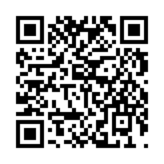
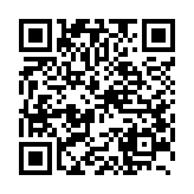

<div align="center">

[🇷🇺 Русский](SUPPORT.md) · 🇬🇧 **English** · [🇪🇬 العربية](SUPPORT_AR.md) · [🇮🇷 فارسی](SUPPORT_FA.md) · [🇨🇳 简体中文](SUPPORT_ZH_CN.md) · [🇪🇸 Español](SUPPORT_ES.md) · [🇹🇷 Türkçe](SUPPORT_TR.md)

</div>

# ❤️ Support Development

If you have found my projects useful, you can voluntarily support their continued development. The projects and all their features remain free and open source regardless of whether you donate.

## 💳 Donate by Card

Choose how you would like to open the donation page on Tribute:

- **[Donate via website](https://web.tribute.tg/d/S0p)**
- **[Donate via Telegram](https://t.me/tribute/app?startapp=dS0p)**

---

<a id="cryptocurrency"></a>
## 🪙 Cryptocurrency

Choose a cryptocurrency and **match the network exactly**. Copy the address or scan its QR code in your wallet. The QR codes contain only the corresponding public receiving addresses.

---

<a id="usdt-tron"></a>
### ₮ USDT · Tron (TRC20)

**Asset:** Tether USD (USDT)\
**Network:** Tron (TRC20)

```text
TG4smVymuDacUsfjZmvfmPCSsKr9xUJkFS
```

<details>
<summary>Show QR code for TRC20</summary>



</details>

---

<a id="usdt-bsc"></a>
### ₮ USDT · BNB Smart Chain (BEP20)

**Asset:** Tether USD (USDT)\
**Network:** BNB Smart Chain (BEP20)

```text
0xD9C2344533e35d7d12B14F4c7852248B5127e2A8
```

<details>
<summary>Show QR code for BEP20</summary>


</details>

---

<a id="usdt-solana"></a>
### ₮ USDT / USDC · Solana (SPL)

**Assets:** Tether USD (USDT), USD Coin (USDC)\
**Network:** Solana (SPL)

```text
BdB4sJBHbrpwqCBANyNzZFiseoMbXUveQ6AH8gdwfERg
```

<details>
<summary>Show QR code for Solana (SPL)</summary>


</details>

---

<a id="usdt-ton"></a>
### GRAM / USDT · TON

**Assets:** Gram (GRAM), Tether USD (USDT)\
**Network:** TON

GRAM is TON's native coin (formerly Toncoin), while USDT is a Jetton token. Both can be received at the same address.

```text
UQCEcONYCy9zd86SxLkFmVECCEtwTOUtjhgGOz8pvDS9u5lP
```

<details>
<summary>Show QR code for TON</summary>


</details>

---

<a id="bitcoin"></a>
### ₿ Bitcoin (BTC)

**Asset:** Bitcoin (BTC)\
**Network:** Bitcoin (native SegWit)

```text
bc1qd82dr7sru37znp9s8r9hdrujctqsdzs5eea5sf
```

<details>
<summary>Show QR code for BTC</summary>



</details>

---

> **Important:** Send only the listed assets on their specified networks: USDT on Tron (TRC20), BNB Smart Chain (BEP20), Solana (SPL), or TON (Jetton); USDC only on Solana (SPL); BTC only on Bitcoin. The same asset on different networks is not interchangeable. Check the full receiving address and network before sending. Blockchain transfers are generally irreversible. Send GRAM only on the TON network.
